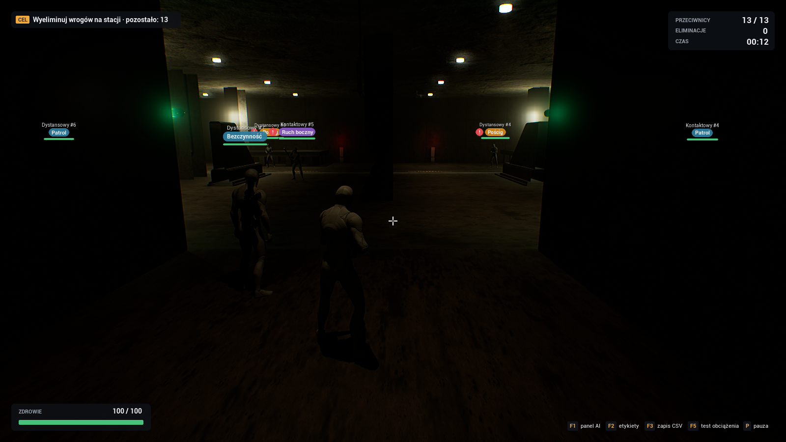

# Metro Enemy AI – Behavior Trees, Telemetry and UI in Unreal Engine 5

A third-person shooter prototype set in a post-apocalyptic metro station, built as the research environment for the engineering thesis *„Implementacja sztucznej inteligencji przeciwników w grze komputerowej z wykorzystaniem Behavior Trees w Unreal Engine”* (Patrycja Brodzik, Uniwersytet DSW Ideis, 2027).

Two enemy types, melee and ranged, share one decision architecture: AI Perception, a Blackboard and a single Behavior Tree. A custom C++ module adds the game UI, a live AI debug panel and CSV telemetry that measures reaction time, behaviour stability and performance.



## Features

- **Shared decision architecture:** `BT_Main` with a root Selector and 8 branches, driven by the `Behavior` Blackboard key; enemies differ only in their attack tasks and parameters.
- **Two enemy types:** melee (`T_MeleeAttack`) and ranged (`T_RangeAttack` with `S_Strafe` and `S_RotateToTarget`).
- **Slate UI in C++:** main menu, HUD, pause and end screens, behaviour labels above enemies, and an AI panel (F1) with a decision log. No Widget Blueprints.
- **Telemetry:** reaction time, behaviour changes, oscillations (return to the previous behaviour within 1 s), time per behaviour and FPS against the number of active NPCs, saved as CSV.
- **Extended map:** `Metro_Rozbudowana` adds a 21 m corridor and a 28 × 35 m technical hall, built reproducibly with an editor Python script.
- **Automation:** `-ThesisTour` captures screenshots, `-ThesisBenchmark=N` runs a measurement session with waves of enemies.

## Results

Measured in a 240 s session on `Metro_Rozbudowana`, with a wave of 5 enemies every 20 s (up to 43 active), on an Intel Core i5‑13400F, RTX 4060 Ti and 32 GB RAM. Raw data: [`Docs/Telemetry`](Docs/Telemetry/2026-11-15_13-57-28).

| Metric | Value |
| --- | --- |
| Reaction time, melee | 0.58 s (0.25–0.99 s, 5 detections) |
| Reaction time, ranged | 1.27 s (0.80–2.01 s, 3 detections) |
| Detections without line of sight | 5 of 13 |
| Behaviour changes / oscillations | 117 / 1 (0.9%) |
| Average FPS at 11–20 / 21–30 / 31–43 NPCs | 73.7 / 61.6 / 46.7 |

FPS covers the whole game, including Lumen and virtual shadow maps, not only the AI.

## Requirements

- Unreal Engine 5.6
- Visual Studio 2022 with the C++ game development workload
- [Git LFS](https://git-lfs.com) for the `.uasset` and `.umap` files

## Getting started

```bash
git lfs install
git clone https://github.com/pbrodzik01/metro-enemy-ai-ue5.git
```

Open `MetroEnemyAI.uproject` and let Unreal build the `MetroEnemyAI` module when it asks. The default map is `Content/Mapy/Metro_Rozbudowana`.

To build from the command line:

```bash
"<UE_5.6>/Engine/Build/BatchFiles/Build.bat" MetroEnemyAIEditor Win64 Development -Project="<path>/MetroEnemyAI.uproject" -WaitMutex
```

## Controls

| Key | Action |
| --- | --- |
| F1 | AI panel |
| F2 | Label mode: all, visible only, off |
| F3 | Save telemetry |
| F5 | Stress test: spawn 5 more enemies |
| P | Pause (also Esc outside the editor) |

## Running a measurement session

```bash
UnrealEditor.exe MetroEnemyAI.uproject -game -windowed -ResX=1600 -ResY=900 -ThesisBenchmark=240
```

The player is invulnerable, a wave of 5 enemies spawns every 20 s, and after 240 s the CSV files are written to `Saved/TelemetriaAI/<timestamp>/` and the game quits.

## Project structure

```
Source/MetroEnemyAI/     C++ module: world subsystem, telemetry, reflection helpers, Slate UI
Content/Mapy/            Metro_Rozbudowana map
Content/Ocalaly/         player and enemy materials and Blueprints
Scripts/                 editor Python scripts that build the map and materials
Docs/                    screenshots, telemetry data and module documentation (Polish)
```

Module documentation in Polish: [`Docs/UI_i_telemetria.md`](Docs/UI_i_telemetria.md).

## Third-party content

This repository is private because it includes content licensed for use, not for public redistribution:

- AI Behavior System, from Fab: the AI controller, `BT_Main`, `BB_Main`, the behaviour component and its tasks, services and decorators
- Metro Maintenance Station, from Fab: the environment
- Unreal Engine template content (mannequins, input, level prototyping) from Epic Games

The C++ module, the editor scripts, the extended map, the materials and the analysis are original work.

## Author

Patrycja Brodzik, Informatyka – Programowanie gier komputerowych, Uniwersytet DSW Ideis, Wrocław.
